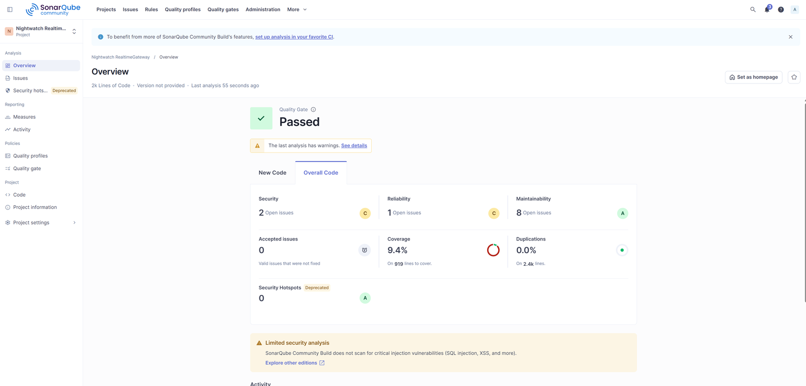

# 🔌 NP-RealtimeGateway

[](https://github.com/JuanDeRe/NP-RealtimeGateway/actions/workflows/ci.yml)

WebSocket gateway of [Nightwatch Protocol](https://github.com/Nightwatch-Protocol/nightwatch-protocol). It keeps persistent player connections and relays traffic between clients and the Game Service. It contains **no game rules**.

## What it does
- Endpoint `/game-ws?access_token=…&match_id=…`
- On connect: checks the **origin**, validates the **JWT** (signature, issuer, audience) and verifies with the Game Service that the **player belongs to the match**
- Accepts client messages `MoveCommand`, `SetDoorStateCommand`, `ChangeCameraCommand` and forwards them over HTTP to the Game Service
- Sends a **match snapshot** on join, then **authoritative events** (player moved, door changed, active camera changed, collectible/empowered updates) to the connected players of that match
- Tracks connections per match with a thread-safe connection manager
- Resolves which Game Service instance hosts a match via a **Redis route** (`matchId → instance`)
- Consumes **match-finished events** from a Redis Stream and broadcasts them to players
- Publishes connection/routing metrics (connected sockets, routing failures, Game Service failures) to **CloudWatch**; `/health` for the ALB

## What was achieved
Real-time synchronization for all players in a match, with authentication at the edge and a single source of truth behind it. Because routes live in Redis, gateway instances are interchangeable and scale horizontally.

## Tech stack
C# · .NET 9 · ASP.NET Core WebSockets · JWT · Redis (routes, Streams) · CloudWatch · Docker · GitHub Actions

## Run locally
```bash
docker run -p 6379:6379 redis
dotnet run
```
Config: `Jwt__Key/Issuer/Audience` (must match Auth), `GameService__BaseUrl`, `Redis__ConnectionString`, `Cors__AllowedOrigins__0`.

## Design
- **Gateway pattern:** a single place for WebSocket handling, JWT validation and routing
- **Cache-aside route resolution:** `RedisMatchRouteResolver` looks up `matchId → Game Service` in Redis and caches it locally (60 s TTL) to avoid a Redis call per message
- **Event-driven:** `MatchEventStreamProcessor` consumes match events from Redis Streams and broadcasts them

## Code quality
Analyzed with **SonarQube Community**: quality gate **passed**, 2k lines of code, **9.4% coverage** on 919 coverable lines, **0.0% duplication**.



## Notes / limitations
- The token is passed as a query parameter (a browser-WebSocket limitation); use WSS in production.
- Each match event is delivered per connection; no backpressure or reconnection resume yet.

## Part of Nightwatch Protocol
[Main repo](https://github.com/Nightwatch-Protocol/nightwatch-protocol) · [Unity Client](https://github.com/JuanDeRe/Nightwatch-Protocol-Unity-Client) · [Auth](https://github.com/JuanDeRe/NP-AuthService) · [Matchmaking](https://github.com/JuanDeRe/NP-MatchmakingService) · **Gateway** · [Game Service](https://github.com/JuanDeRe/NP-GameService) · [Terraform](https://github.com/JuanDeRe/NP-Terraform)
